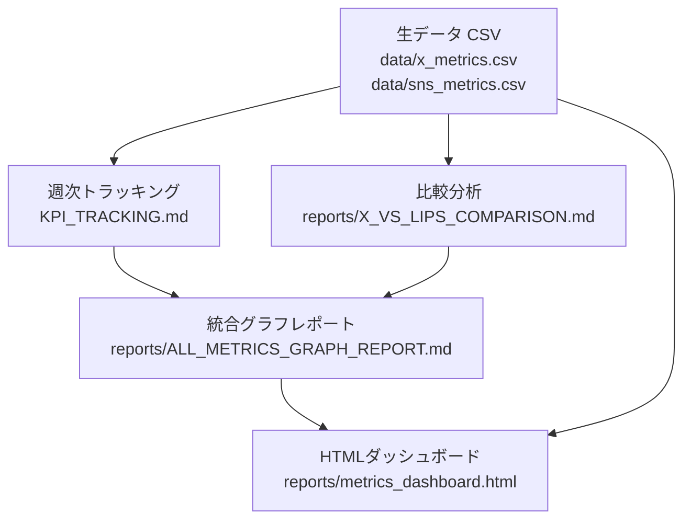

# 📋 実装仕様・運用ルール（Implementation & Operations Guide）

本ドキュメントは、Veronica Growth Projectにおける現在の実装アーキテクチャ、データ連携フロー、レポート生成・可視化機能、および保守・運用ルールを定義する。

---

## 1. プロジェクト概要とアーキテクチャ

本リポジトリは、美容情報発信アカウント（`@Veronica_kuma` / Veronica）の持続的な運用体制とフォロワー目標達成（2027年1月18日までにX 1,000人）を支援するためのデータ分析・可視化・運用管理基盤である。

---

## 2. 実装コンポーネント詳細

### 2.1 データ管理レイヤー (`data/`)
- [data/x_metrics.csv](file:///c:/Users/ri/.gemini/antigravity-ide/scratch/veronica-growth-project/data/x_metrics.csv): 
  - 過去投稿23件＋直近投稿の抜粋データ。
  - 主要カラム: 投稿日、カテゴリ、PR/自費区分、表示回数、いいね、RT、リプライ、エンゲージメント率、フォロワー数など。
- [data/sns_metrics.csv](file:///c:/Users/ri/.gemini/antigravity-ide/scratch/veronica-growth-project/data/sns_metrics.csv):
  - 2026年秋以降のXおよびLIPSの時間差（初動、3日後、7〜8日後）を記録した統合トラッキングデータ。
  - 媒体別（X, LIPS）、指標別（表示回数、いいね、保存/クリップ数等）の推移を保持。

### 2.2 KPIトラッキングレイヤー (`KPI_TRACKING.md`)
- [KPI_TRACKING.md](file:///c:/Users/ri/.gemini/antigravity-ide/scratch/veronica-growth-project/KPI_TRACKING.md):
  - 週次定点観測（W0〜W18、終了目標: 2027-01-18）。
  - XおよびLIPSのフォロワー数推移、週間増減、施策イベント、進捗ギャップを管理。

### 2.3 分析・レポートレイヤー (`reports/`)
- [reports/X_VS_LIPS_COMPARISON.md](file:///c:/Users/ri/.gemini/antigravity-ide/scratch/veronica-growth-project/reports/X_VS_LIPS_COMPARISON.md):
  - オルビス・フェリアモ等の同一投稿におけるXとLIPSの挙動・アルゴリズム差異の比較レポート。
- [reports/ALL_METRICS_GRAPH_REPORT.md](file:///c:/Users/ri/.gemini/antigravity-ide/scratch/veronica-growth-project/reports/ALL_METRICS_GRAPH_REPORT.md):
  - 全数値推移をMermaidチャート（`xychart-beta`）を用いてMarkdown内で視覚化した統合レポート。
  - フォロワー推移、時間差伸び（ロングテール倍率）、PR vs 自費、カテゴリ別パフォーマンスを網羅。
- [reports/metrics_dashboard.html](file:///c:/Users/ri/.gemini/antigravity-ide/scratch/veronica-growth-project/reports/metrics_dashboard.html):
  - スライド発表・プレゼン用のリッチなスタンドアロンHTMLダッシュボード。
  - Chart.jsによる動的グラフ（フォロワー推移、ロングテール倍率、カテゴリ別レーダー/バーチャート、PR比較）。
  - ダークモダン＋グラデーション＋グラスモフィズムのUI設計。

---

## 3. データ更新・レポート運用フロー

週次のデータ測定および新しい投稿の計測時は、以下の順序で更新を行うこと。

1. **データ入力**:
   - `data/sns_metrics.csv` に新規計測値（初動・追跡ログ）を追記する。
   - 必要に応じて `data/x_metrics.csv` を更新する。
2. **KPIの更新**:
   - `KPI_TRACKING.md` の対象週（Week）行に最新フォロワー数、増減、実施施策を記録する。
3. **Markdownレポートの反映**:
   - `reports/ALL_METRICS_GRAPH_REPORT.md` 内のMermaidグラフデータ配列および数値テーブルを最新化する。
4. **ダッシュボードの同期**:
   - `reports/metrics_dashboard.html` 内の Chart.js データセット（`labels`, `data`）を最新値に更新する。
5. **整合性チェック**:
   - 各ファイル間（CSV、KPI、MDレポート、HTML）で数値に矛盾がないことを確認する。

---

## 4. 厳守ルール（Guardrails & Constraints）

1. **元データの保全**:
   - `data/` 配下のCSVは上書き改ざんを行わず、実績値に基づき正確に行追加・更新を行うこと。
2. **事実（Fact）と推測（Hypothesis）の分離**:
   - 分析・レポートでは取得した数値データと、その要因分析（アルゴリズムの影響、外部拡散等）を明確に分けて記載すること。
3. **整合性の維持**:
   - レポートやHTMLダッシュボードに記載する数値は、必ず `KPI_TRACKING.md` や `data/*.csv` と一致させること。
4. **担当・署名の記録**:
   - レポート作成・更新時は担当AI（ヴェロくま）、使用モデル、実行日、変更ファイルを明記すること。
