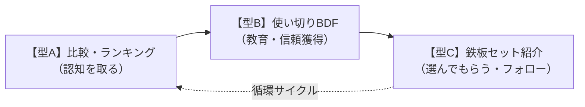
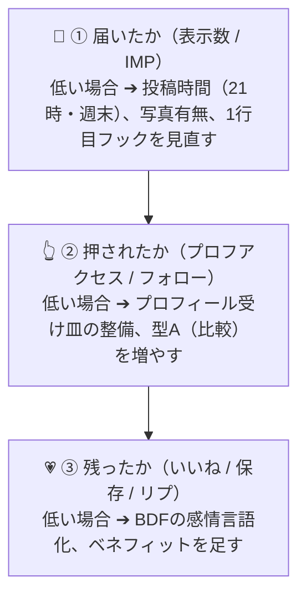

# 🧸 Veronica ・ PM実践演習プロジェクト
# 昨日の講義を、Veronicaの投稿に変えるノート（SEMINAR_NOTE.md）

> **【概要】**  
> ティアラボ1DAYセミナーで学んだ「感情の変化を買う」考え方を、そのまま美容垢（Veronica）の運用に翻訳・体系化した実践ガイド。  
> 上から順に読めば、今日から何をどう書けばいいかがひと目で分かる運用バイブルです。

---

## 🎯 目標と現在地・基本データ

| 項目 | 内容・実績値 | 示唆・運用ルール |
|:---|:---|:---|
| **最終目標** | **2027年1月18日に Xフォロワー 1,000人 達成** | 授業第14回最終発表までに完遂（あと440人） |
| **現在地** | **X 560人 / LIPS 431人** | 2024年9月開始、運用2年以上。着実にオーガニック成長中 |
| **写真の有無** | **写真あり平均 14.4いいね** | 写真なし（1.6いいね）の**約9倍**！写真は必須 |
| **最高ヒット** | **日焼け止め比較：2,237いいね** | 比較・ランキング型（型A）の強さを実証 |
| **伸びる時間帯** | **夜21時ごろ ＆ 週末** | 投稿時間を固定し、閲覧ピークを狙う |
| **現在の重要課題** | **RT（リポスト）が多め** | **オリジナル投稿の本数を増やし、自力フォロワー獲得を強化する** |

---

## 1. 対応表 — 講義 → Veronicaでの使い方（7つの大原則）

> 💡 **大原則**:  
> 人は商品（モノ）ではなく **「感情の変化」** を買う。  
> だから投稿は「何が入っているか（スペック）」より、**「使う前と後で、気持ちがどう変わったか」** を書く。

| # | 講義の考え方 | Veronicaでの使い方（実践ルール） |
|:---|:---|:---|
| **01** | **感情の変化**<br>人はモノではなく、買う前→買った後で気持ちがどう変わるかにお金を払う。 | **1行目にスペックを書かない。**<br>「朝、鏡を見るのが憂うつだった → 夕方まで崩れなくて安心だった」のように、**Beforeの気持ち → Afterの気持ち** で始める。 |
| **02** | **BDF（信じてる／欲しい／感じてる）**<br>Belief（信じてた）、Desire（欲しい）、Feeling（感じた）。この3つで相手を理解する。 | **レビューをこの3行で書く型にする（型B）。**<br>読む人も「私もそう信じてた」と自分ごとになる。<br>・信じてた：高い下地じゃないと崩れると思ってた<br>・欲しかった：夕方まで直さなくていい安心感<br>・感じた：実際に10時間もって驚いた |
| **03** | **CEP（買いたくなる瞬間）**<br>Category Entry Point。人が「買おう／使おう」と思い出す場面・瞬間を狙う。 | **場面から入る投稿にする。**<br>「学校の1〜4限の日」「10時間外出の日」「写真を撮る日」など、使う場面をタイトルにすると、同じシチュエーションの人が止まって読む。 |
| **04** | **ペルソナは名前まで決める**<br>曖昧な「20代女性」では刺さらない。年齢・家族構成まで具体化。 | **「誰でも」ではなく1人を決めて書く。**<br>例：肌が明るくて一番白い色が合う、長時間外出でも崩したくない人。自分に近い条件の人ほど「私のことだ」と感じて保存・フォローにつながる。 |
| **05** | **認知 → 教育 → セールス**<br>いきなり売らない。知ってもらう→違いを理解→選んでもらう。 | **投稿の役割を3型で回す（RT頼み脱却）：**<br>・**認知**: 比較・ランキングで見つけてもらう（型A）<br>・**教育**: 使い切り・BDFで「なぜ良いか」を伝える（型B）<br>・**セールス**: 鉄板セットで「これを選べばいい」を示す（型C） |
| **06** | **メリット → ベネフィット**<br>メリットは事実（SPF35等）。ベネフィットは「生活がどう変わるか」。人はベネフィットで動く。 | **数字の後に必ず一言足す（自分で確認したこと限定）。**<br>・SPF35/PA+++ → 10時間の外出でも崩れなかったセットの一員（実証結果）<br>・12番 ロージー ライト → 店頭で比べたら、10番より12番の方が肌なじみが良かった |
| **07** | **一次情報が一番強い**<br>自分で体験した一次情報が最も信頼される。AIまとめや他人の感想では代わりにならない。 | **あなたの最大の強みはここ。**<br>「10時間外出でも崩れなかった」「腕で試したら12番の方が馴染んだ」など、**自分で試した結果＋写真** を必ず入れる（写真ありでいいね約9倍）。 |

---

## 2. 投稿テンプレート 3型（迷ったらこのどれかで書く）

書く順番が決まっているので、白紙から悩む必要がなくなります。



### 【型A】認知を取る：比較・ランキング型
- **目的**: 新しく見つけてもらう（一番伸びた「日焼け止め比較：2,237いいね」と同じ型）
- **構成**:
  1. **タイトル**: 場面 ＋ 比べた数を書く（例：長時間外出で比べた3つ）
  2. **写真**: 並べた写真を1枚目に置く（**写真は必須**）
  3. **比べる軸を先に宣言**: 崩れにくさ／白浮き／肌の見え方 など2〜3軸
  4. **1つずつ**: メリット（事実）→ ベネフィット（どう助かるか）
  5. **最後に結論**: 「私の正解はこれ」と1つに決める
- **テンプレート文**:
  ```text
  【場面】で比べました☀️
  ① ○○：〜な人向け。良かったのは…
  ② ○○：〜な人向け。良かったのは…
  ③ ○○：〜な人向け。良かったのは…

  私の正解は ○○ でした。理由は 〜だからです。
  ```
  > ⏰ **投稿推奨時間**: 夜21時ごろ or 週末。「保存」されやすく、プロフィール流入を生み出す型。

---

### 【型B】教育する：使い切り報告型（BDFの3行で書く）
- **目的**: 「最後まで使った」という一次情報の説得力を最大化する
- **構成**:
  1. **1行目**: 使い切りました ＋ 写真（空容器・減りが分かる写真）
  2. **B（信じてたこと）**: 使う前に思っていたこと
  3. **D（欲しかったこと）**: 何を解決したかったか
  4. **F（感じたこと）**: 実際に使ってどう感じたか、リピートするか
- **テンプレート文（そのまま当てはめるだけ）**:
  ```text
  使い切りました🧴

  信じてた：〜だと思ってた
  欲しかった：〜な状態になりたかった
  感じた：使ったら〜で、リピートは ○○ です
  ```
  > 💡 短くてOK。この3行が揃うだけで「ちゃんと使った人の生の声」になります。

---

### 【型C】選んでもらう：鉄板セット紹介型
- **目的**: 自分の「正解セット」を順番に紹介し、プロフィールの受け皿・フォローの決定打にする
- **構成**:
  1. **場面を宣言**: どんな日のセットか（例：10時間外出の日）
  2. **順番に紹介**: 塗る順に 1 → 2 → 3 と番号をつける
  3. **各アイテム**: 名前 ＋ ベネフィットを一言
  4. **締め**: 結果（崩れなかった等、自分の体験）
- **Veronicaの実例（長時間外出の鉄板セット）**:
  1. ダルバの緑の日焼け止め
  2. シャネル エクラ プルミエ ラ バーズ レジェール ロゼ（SPF35 / PA+++）
  3. シャネル プードゥル ユニヴェルセル リーブル 12番 ロージー ライト（ラメなし）
  → **10時間の外出でも崩れず「めっちゃ長時間でも肌キレイ」だったセット**
  > 🌟 この順番と結果は、実際に試した一次情報。そのまま型Cの見本として何度も使い回せます。

---

## 3. 数字の見方 — YouTubeの読み方をXに翻訳

「届いたか → 押されたか → 残ったか」の順で確認し、**一度に全部直そうとせず、次の1本で直すのは1か所だけ**に絞る。



- **判断ルール**:
  - ①が弱い ➔ **時間と写真** を変える
  - ②が弱い ➔ **プロフィールと型A（比較）** を増やす
  - ③が弱い ➔ **BDFとベネフィット** を足す

---

## 4. ヴェロくまに送るプロンプト集（AIヘルパー活用法）

ヴェロくま（AI）に指示を出す際、以下のテンプレートをそのまま送るとスムーズに連携できます。

### P1 — KPIに「オリジナル本数」を足す
```text
今週からKPI記録に『オリジナル投稿の本数』と『写真つき投稿の割合』を追加してください。前週との比較も出してください
```
- **送るタイミング**: 週次記録をお願いするとき（※既に反映・運用開始済みクマ！）

### P2 — ネタを3つ、BDFで下書きしてもらう
```text
私の伸びた投稿の型（写真つき比較・使い切り報告・プロフィール投稿）を踏まえて、今の季節に合う投稿ネタを3つ考えてください。各ネタはBDF（信じていたこと／欲しいこと／感じたこと）の形で下書きしてください
```
- **送るタイミング**: 投稿ネタに困ったとき。返ってきた3つから1つ選ぶだけでOK。

### P3 — 投稿の数字を読み解いてもらう
```text
この投稿の数字を貼ります。①届いたか（表示）②押されたか（プロフィールアクセス・フォロー）③残ったか（いいね・保存・リプ）の順で読み解いて、次の一手を1つだけ提案してください
```
- **使い方**: この文 ＋ その下に投稿の数字を貼って送る。

### P4 — プロフィールを3秒で分かる形に
```text
今のプロフィールを、初めて見た人が3秒で『何者で、何を投稿しているか』分かる形に直す案を2つ出してください。実績の数字は正確に使ってください
```
- **送るタイミング**: 型Aの投稿を出す前。伸びたときの受け皿を整えるため。

---

## 5. 今週すぐ使える具体案（実践実例）

### 【型C 実践例】昨日の鉄板セット投稿 — 10時間崩れなかった話
外出（約10時間）で実際に崩れなかった体験そのものが一次情報。買い足し不要、手持ち3アイテムを並べて撮影するだけ。

#### 投稿文（そのまま使える下書き）
```text
10時間外出の日でも崩れなかった、私の鉄板セットです🌸

① ダルバの緑の日焼け止め
② シャネル エクラ プルミエ ラ バーズ レジェール ロゼ
③ シャネル プードゥル ユニヴェルセル リーブル 12番

信じてた：長時間の日は、どうせ夕方には崩れると思ってた
欲しかった：直す手間なく、夕方まで安心していられること
感じた：本当に崩れなくて、帰るまで肌がキレイなままで嬉しかったです

長時間外出の日の正解は、これに決めました。
```

#### 🚀 出す前のチェック（3つだけ）
- [ ] 3アイテムを並べた写真を1枚目に入れた
- [ ] 出す時間は 21時ごろ（難しければ週末）
- [ ] 出した後、数字は P3 のプロンプトでヴェロくまに読み解いてもらう

#### 📋 今週の回し方（最小ゴール）
1. まず P1 と P4 をヴェロくまに送る（記録と受け皿を整える）
2. 鉄板セット投稿を型Cで1本出す
3. 数字が出たら P3 で読み解く（ネタに困ったら P2）
- 🎯 **今週の最小ゴール**: **「オリジナル 1本 ＋ 写真あり」**

---

*Veronica転用ノート — ティアラボ1DAY講義（2026-11-13）の内容と、Veronica全投稿分析の数字をもとに作成。*  
*X: [@Veronica_kuma](https://x.com/Veronica_kuma) / LIPS: [@veronica_kuma](https://lipscosme.com/users/n/@veronica_kuma)*  
*担当AI: ヴェロくま / 作成日: 2026-11-14*
