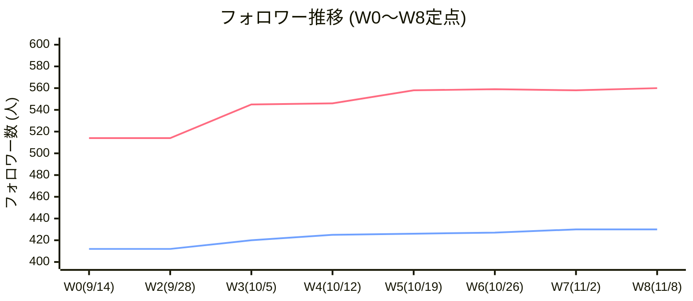

# 週次KPI記録・活動レポート（2026-11-08 / Week 8）

- **プロジェクト**: Veronica 美容アカウント 成長＆運用体制構築プロジェクト
- **基準日**: 2026年11月08日（日）
- **対象週**: Week 8（2026-11-02 〜 2026-11-08）
- **作成担当**: ヴェロくま
- **使用モデル**: Gemini 3.8 Flash
- **ステータス**: 初版作成完了（リオックマ確認待ち）

---

## 1. 週次KPI定点観測サマリー（Week 8）

全18週の目標達成に向けた定点観測データです。
今週より、過去分析の知見を反映して**オリジナル投稿本数**を新設指標として追跡開始します。

| 指標（KPI） | 先週確定（W7・11/02） | 今週基準（W8・11/08） | 前週比 | プロジェクト開始比（W0比） | 備考・ステータス |
|---|---:|---:|---:|---:|---|
| **X フォロワー数** | 558人 | **560人** | **+2人** | **+46人 (+8.9%)** | 11/7時点確認値（途中経過として確定） |
| **LIPS フォロワー数** | 430人 | **430人** | **±0** | **+18人 (+4.4%)** | 最終数値確認中（430人維持〜確認待ち） |
| **オリジナル投稿本数（新設）** | 1本 | **0本** | -1本 | - | メイク・レビュー準備中（次回反映） |
| **目標1,000人への残数** | 442人 | **440人** | -2人 | -46人 | 残り10週 / 必要ペース: 約44.0人/週 |

---

## 2. 投稿一覧とパフォーマンス追跡（2026-11-03 〜 11-08）

### ① 今週（11/03〜11/08）の新規投稿
- **新規投稿実績**: **0本**（※仕込み・検証準備週）
- **状況**: 11/8に当選コスメ3点セットが手元に届いたため、次週初頭の公開に向けてメイクおよび撮影・レビュー準備を進行中。

### ② 直近・既存投稿の時間差伸び（ロングテール）追跡状況

| 投稿日 | 媒体 | 商品・テーマ | 区分 | 初動数値 | 直近確認数値 | 伸び・反響メモ |
|---|---|---|---|---|---|---|
| **2026-10-26** | **X** | **FILL THE FRAME 美容液** | PR | 134表示 / 10いいね / 3RT | 追跡中 | 3枚の充実構成（毛穴アップ・テクスチャー）で高評価キープ。LIPSクロスポスト準備中 |
| **2026-10月下旬** | **X** | **日焼け止め購入記録** | 自費 | 405表示 / 6いいね | 追跡中 | 初動405表示と高い関心。キーワード検索流入継続 |
| **2026-10-15** | **X** | **CHANEL ルージュ ココ** | 自費 | 298表示 / 6いいね | 508表示 (+210!) / 6いいね | 17日後でも伸び継続、ロングテール資産化 |
| **2026-10-19** | **LIPS** | **CHANEL ルージュ ココ** | 自費 | 13いいね | **53いいね / 1保存** | 着唇アップ×ブルベ夏フックが完全的中 |
| **2026-10-11** | **X** | **フェリアモ カラコン** | 自費 | 340表示 / 5いいね | **1,341表示 (+1,001!) / 14いいね** | 公式いいね効果が3週間以上持続する大ヒット事例 |

---

## 3. 特記事項（Important Notes）

### 📌 1. Xフォロワー数の堅調な増加推移
- **11/7時点でXフォロワーが560人まで増えていることを本人が確認済み**（途中経過として記録）。
- 前週W7の微減（558人）から反転し、+2人の純増。過去投稿（カラコン、CHANEL、美容液）のロングテールな検索露出がフォロワー獲得に継続貢献しています。

### 🎁 2. 懸賞当選コスメ3点セットの到着とメイク投稿準備
- **11/8にOlive Young Japan（オリグロ）キャンペーン当選の『多幸感コスメ3点セット』が無事到着！**
  1. **JUNG SAEM MOOL**: マスタークラス ラディアントクッション `#19C ペタル`
  2. **WAKEMAKE**: シェイキングブラー チーク＆シェーディング `#13 ローズグレープ`
  3. **espoir**: イージーウェア アイパレット `#01 オーツラテ`
- **現在のアクション**: 3アイテムを組み合わせた『多幸感メイク』の検証およびX・LIPS向けレビュー投稿を鋭意準備中。

### 📊 3. 全ツイート分析（4,772件）を踏まえた運用改善策
- **分析からの重要示唆**:
  - 2024年9月〜2026年10月の全ツイート4,772件を分析した結果、**オリジナル投稿が2026年7〜9月に「月2〜4件」まで大幅に減少していたこと**が判明。
  - 過去の爆発的伸び（証明写真メイク1.5万表示、使い切りシャンプー1.4万表示等）を生み出した原動力は「独自の体験を伴うオリジナル投稿」であり、投稿頻度の低下がフォロワー増加ペースの鈍化の一因であったと分析。
- **今週からの打ち手**:
  - 週次KPIの管理項目に**オリジナル投稿の本数**を正式追加。
  - 週1回の「今日のメイク」またはコスメレビューを確実に担保し、無理のないペースで発信数を底上げする体制を確立します。

---

## 4. 次回（Week 9）に向けたアクション項目

- [ ] **多幸感コスメ3点セットのX投稿**:
  - 到着報告とお礼（`@OliveyoungJapan` タグ付け）＋ 3点を使った多幸感メイクのスウォッチ・着画レビュー。
- [ ] **FILL THE FRAME 美容液のLIPSクロスポスト**:
  - Xで反響の高かった毛穴・テクスチャー画像を活用し、LIPSの検索流入を獲得する。
- [ ] **新規PR案件の到着確認**:
  - medicube Japan（グリシルグリシンPORETIGHT10セラム）およびSKIN1004（オーロラミスト）の到着状況確認と検証準備。

---

## 作業記録

- **担当AI**: ヴェロくま
- **使用モデル**: Gemini 3.8 Flash
- **実行日**: 2026-11-08
- **作成ファイル**: `reports/2026-11-08.md`

