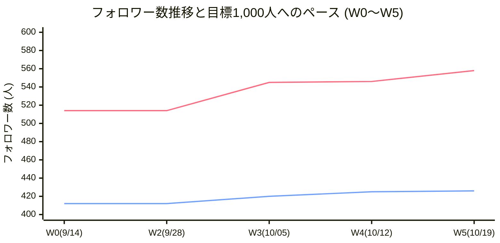
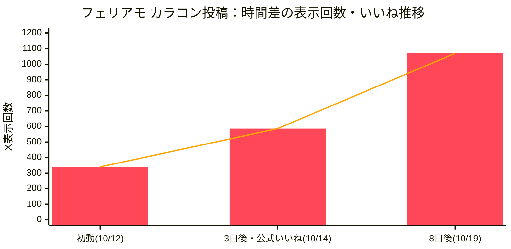
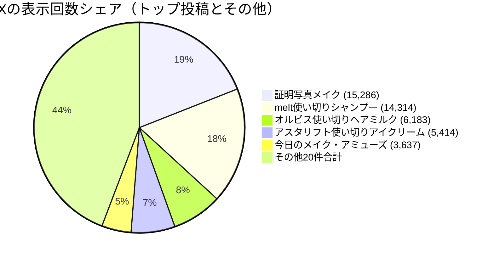

# 📊 プロジェクト統合 数値推移・分析レポート（2026-10-19）

- **プロジェクト**: Veronica 美容アカウント 成長＆運用体制構築プロジェクト
- **集計対象**: プロジェクト全期間（過去実績 2024-11 〜 2026-10-19 最新データ）
- **作成担当**: ヴェロくま
- **使用モデル**: Gemini 3.8 Flash
- **統合元データ**:
  - `KPI_TRACKING.md`（週次フォロワー定点観測 W0〜W5、直近施策推移）
  - `data/x_metrics.csv`（過去抜粋23件 ＋ 直近2件の計25件）
  - `data/sns_metrics.csv`（直近詳細トラッキング）
  - `reports/X_VS_LIPS_COMPARISON.md`（X vs LIPS 同一投稿比較データ）
  - `CURRENT_ANALYSIS.md`（過去ベースライン分析）

---

## 1. フォロワー数推移・目標達成進捗（W0〜W5）

X目標1,000人達成に向けた週次推移と、LIPSのフォロワー数推移の総合グラフです。

> 📌 **凡例**:
> - 上段の折れ線（赤・ピンク系）: **X（Twitter）フォロワー数**
> - 下段の折れ線（青系）: **LIPS フォロワー数**

### 📈 週次フォロワー増減とキートリガー

| 週（Week） | 測定基準日 | Xフォロワー | X週間増減 | LIPSフォロワー | LIPS週間増減 | 主な出来事・施策 |
|---|---|---:|---:|---:|---:|---|
| **W0 (開始)** | 2026-09-14 | **514人** | - | **412人** | - | 初期ベースライン測定（残り486人） |
| **W2** | 2026-09-28 | **514人** | ±0 | **412人** | ±0 | 現状分析（過去投稿の棚卸し） |
| **W3** | 2026-10-05 | **545人** | **+31人** | **420人** | **+8人** | **固定ポスト（美容履歴書）刷新**、オルビス投稿 |
| **W4** | 2026-10-12 | **546人** | **+1人** | **425人** | **+5人** | フェリアモ投稿（一時550人到達後、相互整理等で微調整） |
| **W5 (最新)** | 2026-10-19 | **558人** | **+12人** | **426人** | **+1人** | **フェリアモ公式いいね効果の持続**、時間差伸び |
| **累計成長** | - | **+44人** | - | **+14人** | - | **開始からX +8.6%増、LIPS +3.4%増** |

---

## 2. 初動から時間差でどう伸びたか（ロングテール検証）

XとLIPSの特性差が如実に現れた「初動（翌日）➔ 数日後 ➔ 7〜8日後」の時間差伸び（ロングテール）の比較推移です。

### 🔍 時間差追跡データまとめ

| 投稿 | 媒体 | 指標 | 初動（翌日） | 3日後 | 7〜8日後（現在） | 時間差倍率 | 発生要因 |
|---|---|---|---:|---:|---:|---:|---|
| **フェリアモ カラコン** | **X** | **表示回数** | 340 | 586 | **1,070** | **3.15倍** | **公式いいね獲得**＋検索流入 |
| | **X** | **いいね** | 5 | 13 | **14** | **2.80倍** | ブランド公式による拡散波及 |
| | **LIPS** | **いいね** | 42 (初動) | 42 | **49** | **1.17倍** | コスメ特化検索によるじわじわ加算 |
| **オルビス クレンジング** | **X** | **表示回数** | 47 | - | **314** | **6.68倍** | 毛穴・角栓キーワードの持続検索 |
| | **LIPS** | **いいね** | 13 | - | **57** | **4.38倍** | ランキング・悩みタグ経由の保存・いいね |

> 💡 **ロングテールの特徴（媒体差）**:
> - **X**: **「表示回数（インプレッション）」が爆発する**（検索・アルゴリズム・公式RT/いいねで外部へ一気に広がる）。
> - **LIPS**: **「いいね・クリップ数」が後からじわじわ積み上がる**（アプリ内検索で悩みを抱えたユーザーに長期間届く）。

---

## 3. PR投稿 vs 通常（自費購入）投稿のエンゲージメント比較

PR投稿と通常（自費）投稿で、読者の反応がどう違うのかを可視化しました。

```mermaid
---
config:
  xyChart:
    width: 780
    height: 380
  themeVariables:
    xyChart:
      plotColorPalette: "#5352ed, #ff4757"
---
xychart-beta
    title "PR区分別の中央値比較 (X実績)"
    x-axis ["表示回数(÷100)", "いいね数", "いいね率(x10%)"]
    y-axis "数値スケール" 0 --> 45
    bar [12.4, 48, 38.4]
    bar [19.8, 41, 19.3]
```

> 📌 **凡例**:
> - 左側のバー（青系）: **PR投稿（中央値）**
> - 右側のバー（赤系）: **通常・自費投稿（中央値）**

### 📊 PR vs 通常の指標実績表（X全件分析）

| 区分 | 投稿件数 | 表示回数（中央値） | 表示回数（平均） | いいね数（中央値） | いいね率（中央値） | ブックマーク（合計） |
|---|---:|---:|---:|---:|---:|---:|
| **PR投稿** | 7件 | 1,239 | 1,858 | **48件** | **3.84%** | 2件 |
| **通常投稿** | 18件 | **1,980** | **4,082** | 41件 | **1.93%** | **23件** |

> 💡 **分析インサイト**:
> 1. **表示回数は「通常投稿」の圧勝（約1.6〜2.2倍）**:
>    - 「使い切りコスメ」「証明写真メイク」「毛穴クレンジング」など、リアルな本音や悩み解決は拡散されやすい。
> 2. **いいね率は「PR投稿」が高い（約2倍）**:
>    - PR投稿は写真の作り込みやブランドへの応援心理、プレゼント当選報告などでフォロワーからの温かい「いいね」が集まりやすい。
> 3. **ブックマーク（保存）は「通常投稿」に集中**:
>    - 「後で買う」「真似する」ための保存は、圧倒的に自費購入・使い切りのリアルレビューに偏っている。

---

## 4. X vs LIPS 同一投稿5件の横断パフォーマンス比較

同じ商品・同じタイミングで投稿した5件のデータを合体させた比較です。

```mermaid
---
config:
  xyChart:
    width: 780
    height: 380
  themeVariables:
    xyChart:
      plotColorPalette: "#70a1ff, #ff6b81"
---
xychart-beta
    title "同一投稿における LIPSいいね数 vs Xいいね数"
    x-axis ["ululis黒", "プルント", "アノブ", "オルビス", "フェリアモ"]
    y-axis "いいね数" 0 --> 70
    bar [50, 53, 56, 57, 49]
    bar [12, 14, 9, 11, 14]
```

> 📌 **凡例**:
> - 左側のバー（青系）: **LIPS いいね数**（49〜57件と高水準で極めて安定）
> - 右側のバー（赤系）: **X いいね数**（9〜14件のレンジ）

### 📋 同一5投稿の詳細データ一覧

| # | 投稿日 | 商品・テーマ | 区分 | X 表示 | X いいね | X 保存 | LIPS いいね | LIPS 保存 | LIPS コメント |
|---|---|---|---|---:|---:|---:|---:|---:|---:|
| 1 | 2026-08-16 | **ululis マトメイク黒** | 自費 | **635** | 12 | 0 | **50** | **3** | **2** |
| 2 | 2026-09-29 | **プルント シャンプー** | PR | 263 | 14 | 0 | **53** | 2 | 0 |
| 3 | 2026-10-01 | **アノブ シャンプー** | PR | 146 | 9 | 0 | **56** | 1 | 2 |
| 4 | 2026-10-05 | **オルビス クレンジング** | 自費 | 314 | 11 | 0 | **57** | 1 | 1 |
| 5 | 2026-10-11 | **フェリアモ カラコン** | 自費 | **1,070** | **14** | **2** | **49** | 1 | 1 |

---

## 5. X過去全投稿（時系列・表示回数トップ層の分布）

Xで過去に記録された表示回数トップ層の傾向です。

- **1万回超えの爆発ヒット**: 「使い切りシャンプー（1.4万）」および「裸眼パスポート用証明写真メイク（1.5万）」の2件。
- **共通項**: **「具体的シチュエーション（証明写真、使い切りの本音）」×「プチプラ・身近なコスメ」**。

---

## 6. まとめ・今後の発表で使えるキーストーリー

1. **フォロワー増加のドライバー**:
   - 最大のフォロワー急増は **固定ポスト（美容履歴書）の整備時（+31人）**。
   - 投稿単体のヒットだけでなく、「プロフィールの受け皿」が整っていることが伸びに直結した。
2. **公式アクションと時間差の掛け算**:
   - フェリアモのカラコン投稿は、ブランド公式からの「いいね」獲得を機に **表示回数が340回 ➔ 1,070回（+215%）** へと時間差で急拡大。
   - Xのフォロワー増加（W5: +12人）を力強く後押しした。
3. **媒体使い分けの最適解**:
   - **LIPS**: どんなコスメでも40〜50いいねが安定してつき、特にヘアケアや着画が高エンゲージ。
   - **X**: キーワード検索や公式反応によって表示回数が何倍にも跳ね上がる。
   - この2つの相乗効果をデータで証明できている点が、本プロジェクト最大の強み。

---

## 作業記録

- **担当AI**: ヴェロくま
- **使用モデル**: Gemini 3.8 Flash
- **実行日**: 2026-10-19
- **作業内容**: プロジェクト内の全数値記録（フォロワー推移、PR比較、ロングテール、同一投稿比較、全件分布）を合体した推移グラフ・分析レポートの作成
- **作成ファイル**: `reports/ALL_METRICS_GRAPH_REPORT.md`
